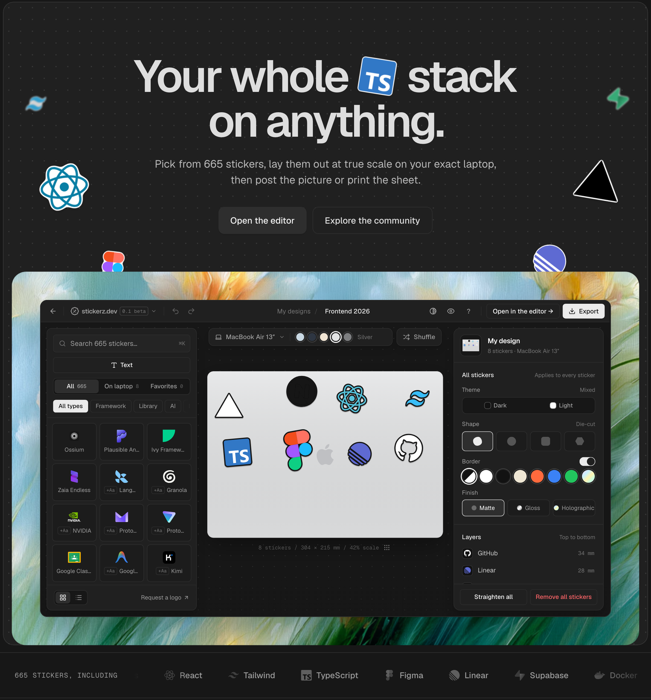
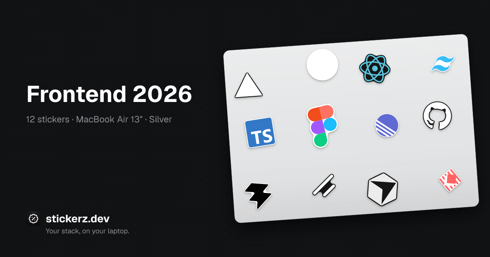
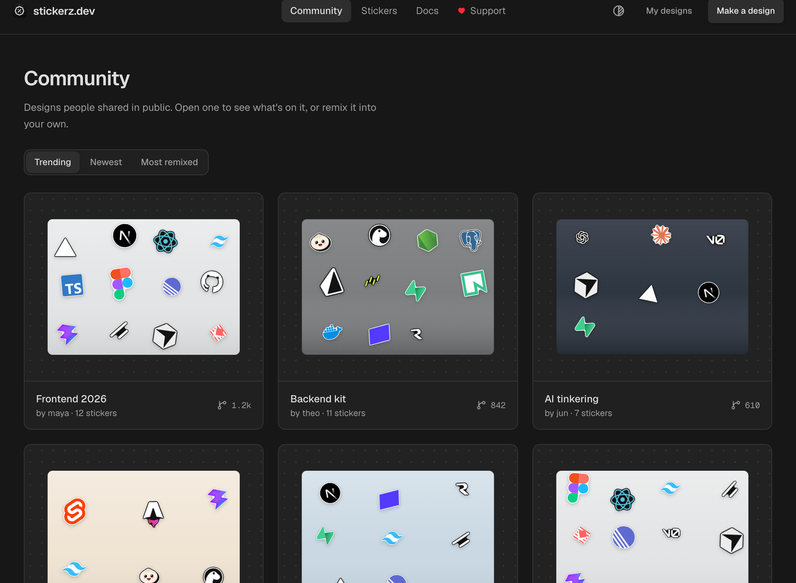

<p align="center">
  <a href="https://stickerz.dev"></a>
</p>

<h1 align="center">stickerz.dev</h1>

<p align="center"><b>Your stack, on your laptop.</b><br/>
Design die-cut stickers of your tech stack at true size, then post the picture or print the sheet.</p>

<p align="center">
  <a href="https://stickerz.dev">stickerz.dev</a> ·
  <a href="https://stickerz.dev/community">Community</a> ·
  <a href="https://stickerz.dev/stickers">Stickers</a> ·
  <a href="https://stickerz.dev/docs/works">Docs</a> ·
  <a href="https://stickerz.dev/brands">For brands</a>
</p>

<p align="center">
  <a href="LICENSE"></a>
  
  
  <a href="https://github.com/PaoloJN/stickerz/issues/new?template=logo-request.yml"></a>
</p>

<a href="https://stickerz.dev"></a>

## What it is

Every developer's laptop has the same stickers on it. Stickerz is a small editor for laying them out on purpose: pick logos from a library of 665 developer stickers, drop them on a lid drawn at the real size of your exact MacBook, nudge, rotate, restyle, and either share the picture or print the sheet and cut it.

No account. Your designs live under an anonymous cookie, and sharing one gives it a link, a page and its own preview card.

- **True size.** The lid is drawn in millimetres from the device's real dimensions (MacBook Air 13″/15″, Pro 13″/14″/16″), so what you see is what you'll stick.
- **Die-cut vinyl.** Every sticker gets a precomputed cut line around its silhouette. Shapes, borders, matte / gloss / holographic finishes, light and dark variants.
- **Text stickers.** Set a word in one of six display fonts; it becomes a vector path like any logo.
- **Your own art.** Drop an SVG or PNG into the editor. It stays on your design only.
- **Print it.** Export PNG, SVG or a print-ready PDF at true scale with cut lines, for a Cricut, a Silhouette or a print shop.
- **Share and remix.** Post a design to the community, remix someone else's, keep yours unlisted or private.

<p align="center"></p>
<p align="center"><sub>Every shared design renders its own social card, so the link unfurls as the design itself.</sub></p>

## How it works

1. **Pick your logos.** Search the library, start from a pack, or remix a community design.
2. **Arrange.** Choose the laptop and its colour, drag, resize and rotate. Shuffle gives you a fresh layout.
3. **Share or print.** Post it, copy the link, or export the sheet. The [docs](https://stickerz.dev/docs/print) cover printing at home and at a shop.

<a href="https://stickerz.dev/community"></a>

## Stack

SvelteKit 2 and Svelte 5 (runes), Tailwind v4, shadcn-svelte, Drizzle on Neon Postgres, deployed on Vercel.
Cut lines are traced ahead of time from each logo's alpha with resvg (`scripts/build-cuts.ts`) and shipped as one JSON, so the editor never rasterises anything at run time. Social cards are composed as SVG on the server, with text outlined through opentype.js, and rasterised with resvg.

## Run it locally

```bash
git clone https://github.com/PaoloJN/stickerz.git
cd stickerz
pnpm install
cp .env.example .env
pnpm dev
```

Without `DATABASE_URL` the app runs in mock mode: the community shows seed designs and nothing is stored. Everything else works.

| Variable | What it does |
| --- | --- |
| `DATABASE_URL` | Neon Postgres connection string. `pnpm db:push` creates the tables, `pnpm db:seed` fills the community. |
| `GITHUB_TOKEN` | Fine-grained token with Issues: write. Brand requests open an issue, and the star count works while the repo is private. |
| `GITHUB_ISSUES_REPO` | `owner/name` to open those issues in. Defaults to this repo. |

Useful scripts:

| Script | |
| --- | --- |
| `pnpm test` | Vitest |
| `pnpm check` | svelte-check |
| `pnpm build:cuts -- --only react.svg` | Re-trace the cut line for one logo (omit `--only` for all of them) |
| `pnpm build:icons` | Favicons, PWA icons and the site's social card from `static/icon.svg` |
| `pnpm db:studio` | Browse the database |

## Project layout

```
src/
  routes/            pages: /, /editor, /stickers, /community, /designs, /brands, /docs, /legal, /support
  components/editor  the editor (canvas, library, style panel, export)
  components/site    shared chrome for the marketing pages
  lib/stickers       geometry, cut lines, styles, devices, export, text
  lib/server         database, rate limits, GitHub, social cards
  config/site.ts     name, URL, repo, emails: the one place to change identity
  data/svgs.ts       the logo library index
static/library       the logo SVGs
scripts/             build-cuts, build-icons
```

## Contributing

- **A logo is missing.** [Request it](https://github.com/PaoloJN/stickerz/issues/new?template=logo-request.yml) with a link to the brand's official SVG, or add it yourself: drop the file in `static/library`, add an entry to `src/data/svgs.ts`, run `pnpm build:cuts -- --only <file>.svg`, open a PR.
- **Something's broken.** [Open a bug](https://github.com/PaoloJN/stickerz/issues/new?template=bug_report.md) with a screenshot and, if you can, a link to the design.
- **Bigger ideas.** Open an issue first so we can agree on the shape before you spend the time.

Keep PRs small, say what you tested. `pnpm test` and `pnpm check` should pass.

## For brands

Your logo is probably already on someone's laptop. Brands can [hide, update or feature](https://stickerz.dev/brands) their logo. Removal is free and permanent; the request goes straight to the maintainers.

## Credits

- The logo library started from [svgl](https://github.com/pheralb/svgl) by [pheralb](https://github.com/pheralb). Thank you.
- Logos belong to their owners and are shown so people can make stickers for their own laptops. See the [trademark notice](https://stickerz.dev/legal/trademark).
- [Geist](https://vercel.com/font) by Vercel, [Lucide](https://lucide.dev) icons, [shadcn-svelte](https://shadcn-svelte.com).

## License

[MIT](LICENSE). Built by [Paolo Nessim](https://github.com/PaoloJN).
